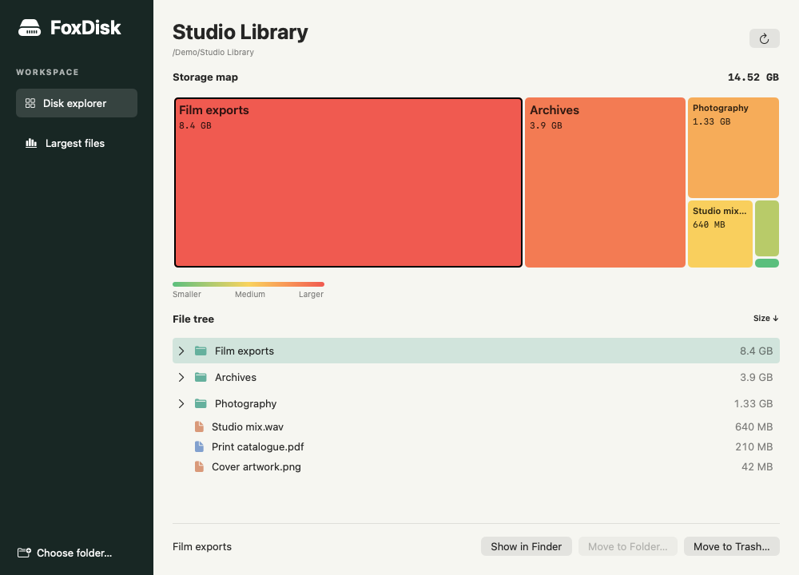
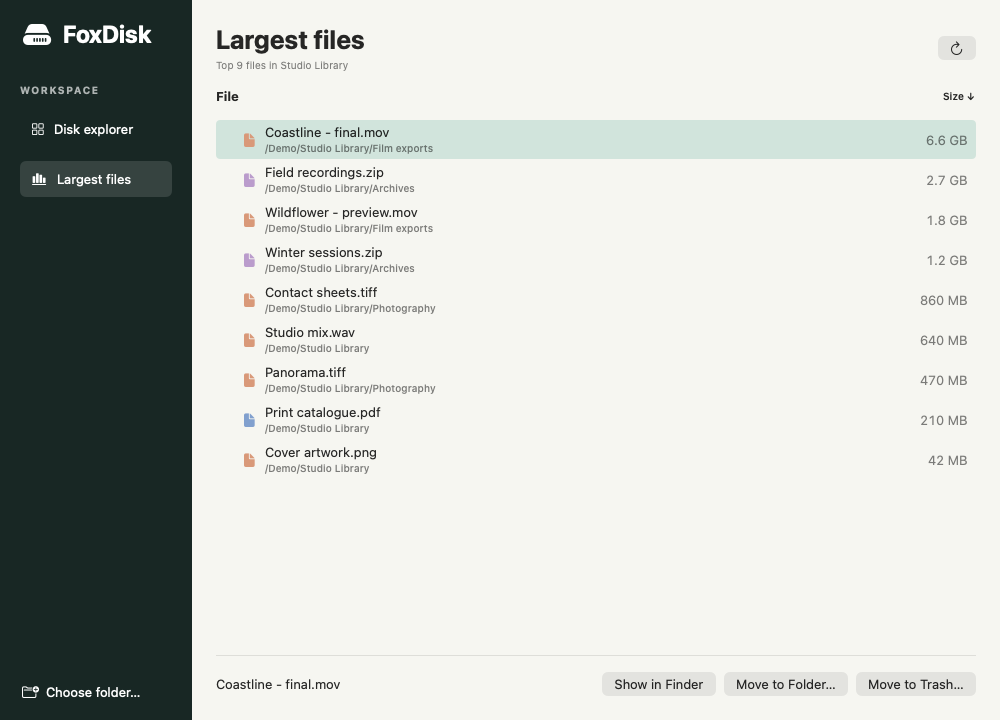

<p align="center"></p>

# FoxDisk

FoxDisk is an open-source macOS tool for managing storage and large files. Choose a folder to see where its space goes, find the largest files across its subfolders, and move files to another folder or the Trash.



## Explore and clean up

- The storage map sizes tiles by byte count. Green, yellow, and red show the progression from smaller to larger items within the current map. Double-click a folder to explore it.
- **Largest files** lists up to 100 files from the entire scan. Select an entry to reveal it in Finder, move it to a folder, or send it to Trash.
- Folder sizes are logical byte totals. Actual disk space reclaimed can differ, and items in Trash continue to occupy storage.
- The scan displays live progress and skips unreadable entries and other mounted filesystems. After an action in FoxDisk, the affected parts of the view update. Use the refresh button to pick up changes made in Finder.



## Install

Requires macOS 13 or later. The universal app supports Intel and Apple silicon. Download the DMG from the repository’s Releases section, open it, and drag FoxDisk into Applications. This build uses an ad-hoc signature and has no Apple notarization. macOS may block a downloaded copy. You can also build it locally.

## Build and test

On a Mac with Xcode or its command-line tools installed, run these commands from the project root.

```sh
./build.sh
open build/FoxDisk.app
```

Run the filesystem regression tests with temporary fixtures.

```sh
swiftc -parse-as-library Sources/Storage.swift Sources/FileActions.swift Sources/LiveUpdate.swift Tests/FileActionsTests.swift -o build/FileActionsTests
build/FileActionsTests
```

Run `./scripts/package.sh` to build the universal app, create a compressed DMG in `dist/`, and verify the disk image.

## Privacy and license

FoxDisk reads local filesystem metadata. The screenshots use a fictional library. The project is distributed under the [MIT License](LICENSE).
